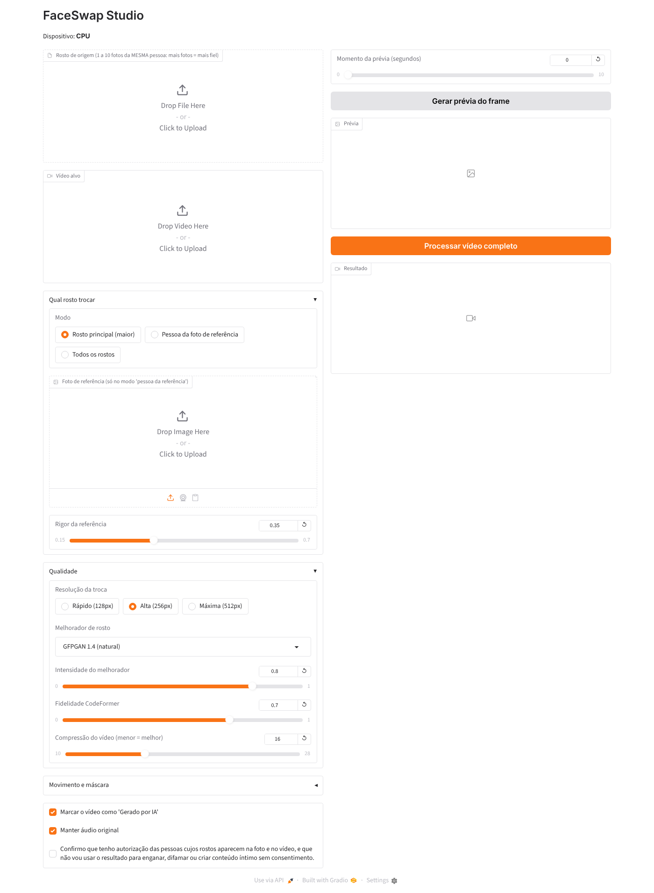

# FaceSwap Studio

Troca de rosto em vídeo com foco em **qualidade**, **movimento suave** e **enquadramento estável**.
Roda localmente na sua GPU NVIDIA (testado para GTX 1660 Super, 6 GB) com interface web.



## Como funciona

| Etapa | Modelo / técnica | Para quê |
|---|---|---|
| Detecção | SCRFD 10G | Acha rostos de frente, de perfil e com pouca luz |
| Identidade | ArcFace w600k | Escolhe a pessoa certa; média de várias fotos de origem |
| Rastreamento | IoU + identidade | Segue cada pessoa entre os frames, inclusive depois de cortes |
| **Suavização** | Mediana + Gaussiana **bidirecional** nos 5 pontos do rosto | Elimina tremido sem atrasar o movimento; preenche frames sem detecção |
| Troca | InSwapper 128 + **pixel boost** (256/512 px) | Gera detalhe real acima de 128 px |
| Máscara | Caixa com borda suave + segmentação BiSeNet | Bordas invisíveis; mãos e objetos na frente do rosto são preservados |
| Estabilidade da máscara | Média móvel entre frames | Evita "piscar" na borda |
| Restauração | GFPGAN 1.4 / GPEN 512 / CodeFormer | Pele e olhos nítidos em 512 px |
| Saída | FFmpeg H.264 (CRF 16, preset slow) + áudio original | Arquivo final com qualidade alta |

O vídeo é processado em duas passadas: primeiro analisa todos os frames (detecção, rastreamento e
suavização), depois renderiza. Isso permite suavizar usando frames futuros, o que dá movimento mais
estável do que qualquer filtro em tempo real.

## Instalação (Windows)

1. Atualize o driver da NVIDIA (versão 580 ou mais recente, exigida pelo CUDA 13).
2. Instale o **Python 3.11 ou 3.12** em python.org, marcando "Add python.exe to PATH".
3. Baixe este repositório e dê dois cliques em **`instalar.bat`**.
   No final deve aparecer `CUDAExecutionProvider` na lista de provedores.
4. Dê dois cliques em **`iniciar.bat`**. O navegador abre em http://127.0.0.1:7860.

Na primeira execução os modelos (cerca de 1,5 GB) são baixados para a pasta `models/`.
Os vídeos prontos ficam em `outputs/`.

**Se a GPU não aparecer:** como alternativa, troque o CUDA pelo DirectML, que funciona com qualquer
GPU no Windows sem instalar CUDA (é um pouco mais lento):

```bat
venv\Scripts\activate
pip uninstall -y onnxruntime-gpu
pip install onnxruntime-directml
```

## Uso

1. **Rosto de origem**: envie de 1 a 10 fotos nítidas da mesma pessoa, de preferência com ângulos e
   expressões diferentes. Mais fotos deixam a identidade mais fiel.
2. **Vídeo alvo**: o vídeo onde o rosto será trocado.
3. **Modo**: maior rosto, uma pessoa específica (envie uma foto dela como referência) ou todos os rostos.
4. Use **Gerar prévia do frame** para ajustar as opções num momento do vídeo antes de processar tudo.
5. Clique em **Processar vídeo completo**.

### Dicas de qualidade

- **Resolução da troca**: "Alta (256px)" é o melhor custo-benefício. "Máxima (512px)" vale para rostos
  grandes na tela (close-ups), mas é cerca de 4x mais lenta na etapa de troca.
- **Melhorador**: GFPGAN é o mais natural. GPEN é mais nítido. CodeFormer aguenta melhor vídeos ruins.
  Se o rosto parecer "plástico", baixe a intensidade para 0,5–0,6.
- **Suavização**: 1,5 é o padrão. Se ainda houver tremido, suba para 2,5–3. Se o rosto "escorregar" em
  movimentos muito rápidos, baixe para 0,8–1.
- **Recuo da máscara**: se aparecer a testa ou o queixo original, ajuste os recuos superior e inferior.
- Fotos de origem e vídeo com iluminação parecida dão o resultado mais realista.

## Linha de comando

```bat
venv\Scripts\activate
python cli.py -s foto1.jpg foto2.jpg -t video.mp4 -o saida.mp4 --boost 2 --enhancer gfpgan_1.4
python cli.py -s rosto.jpg -t video.mp4 -o saida.mp4 --mode reference --reference pessoa.jpg
```

## Uso responsável

Use apenas com o consentimento das pessoas envolvidas. A interface exige essa confirmação e, por
padrão, marca o vídeo como "Gerado por IA". Não use para enganar, fraudar, difamar ou criar conteúdo
íntimo de ninguém. Em muitos países isso é crime.

## Créditos dos modelos

InsightFace (SCRFD, ArcFace, InSwapper — uso não comercial), GFPGAN, GPEN, CodeFormer, BiSeNet.
Versões ONNX distribuídas pelo projeto FaceFusion. Verifique as licenças de cada modelo antes de
qualquer uso comercial.
